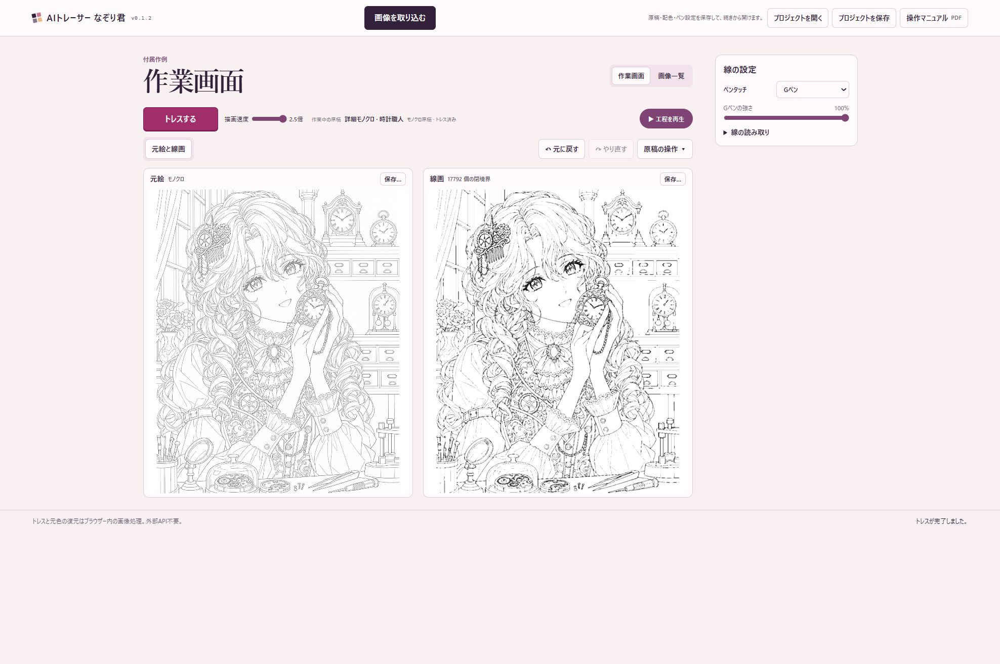
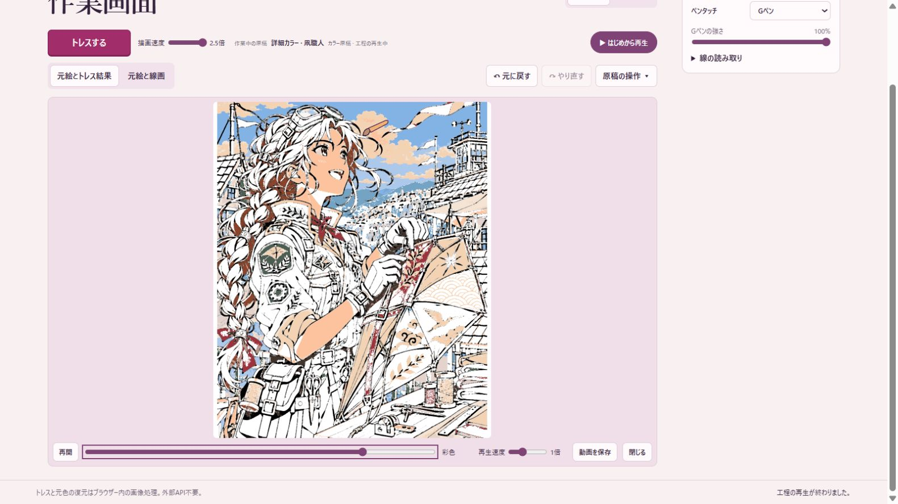

# AI Tracer Nazori-kun / AIトレーサー なぞり君

[](https://furuyan1234.github.io/ai-tracer-nazori-kun/)
[](https://github.com/FURUYAN1234/ai-tracer-nazori-kun/releases/latest/download/nazori-kun-manual.pdf)

[Illustrated guide and narrated demo / 画像付き解説と実演動画（note）](https://note.com/happy_duck780/n/n75301de9493a) · [Releases / リリース](https://github.com/FURUYAN1234/ai-tracer-nazori-kun/releases) · [AI Manga Creative Suite](https://note.com/happy_duck780/n/nbdf826604ce7)

Watch a pen retrace the lines in an illustration. On a color original, a brush then applies colors sampled from the same image. When the drawing ends, the workspace puts the original beside the reconstructed result. / イラストを読み込み、ペン先が元絵をなぞって線を引き直すところを見られます。カラー原稿ではその後、筆が元絵から拾った色を塗ります。工程が終わると、作業画面に元絵とトレス結果が並びます。

Tracing and reconstruction run in the browser. The drawing is processed using image analysis, and it is never sent to an AI service. No API key or AI subscription is required. / トレスと元色の復元はブラウザー内の画像処理で行います。原稿は外部サービスへ送信されず、生成AIサービスへの登録やAPIキーも不要です。


## Try the built-in examples / 付属作例で試す

1. Open the web app and click **トレスする** (Trace) on the color kite-maker example. The cursor switches from a pen to a brush. A color result appears on the right when tracing ends. / Webアプリを開き、カラー作例「凧職人」で **トレスする** を押します。ペン先が筆先に切り替わり、最後は右に色付きの結果が並びます。
2. From **画像一覧** (Image list), find the monochrome clock-maker, then choose **作業画面で開く**. Trace it to see how a monochrome original becomes line art. The list also includes two courier samples. / **画像一覧**で白黒の「時計職人」を探し、**作業画面で開く**を押します。白黒原稿は線画まで仕上がります。配達員の白黒・カラー作例も使えます。
3. Choose **画像を取り込む** to work with your own PNG, JPEG or WebP files. You can select multiple files, then switch between them from the image list. / 自分の原稿を使う場合は、上部の **画像を取り込む** からPNG・JPEG・WebPを選びます。複数選択でき、読み込み後は画像一覧から作業する原稿を開けます。



## Change the pen and review the process / ペンタッチを調整し、工程を見る

Choose G-pen, round pen, brush pen, or the extracted outline under **ペンタッチ**. **Gペンの強さ** changes the contrast between thinner and heavier parts of a G-pen stroke. For pale monochrome lines, adjust **線の読み取り → 濃さのしきい値** and run the trace again. / **ペンタッチ** でGペン、丸ペン、筆ペン、輪郭そのままを選べます。**Gペンの強さ** で入り抜きや太さの差を調整します。白黒の淡い線を拾いたい場合は **線の読み取り → 濃さのしきい値** を調整してトレスし直します。

**描画速度** sets the speed of the initial trace. **工程を再生** plays the sequence from the beginning. Pause or seek with the timeline, and change **再生速度** independently. **動画を保存** exports the replay as WebM when the browser provides a supported encoder. / **描画速度** はトレス時の速さです。**工程を再生** で最初から見直せます。一時停止やシークバーで途中へ移動し、**再生速度** を別に調整できます。対応ブラウザーでは **動画を保存** からWebMに保存できます。



For a color result, select a palette swatch, choose a replacement color, and click **適用**. Regions sharing that color layer change together. **配色 AとBを比べる** previews two alternatives. **元に戻す** and **やり直す** can restore changes. / カラー結果の色チップを開き、色を選んで **適用** を押すと、その色レイヤーに入っている箇所が変わります。**配色 AとBを比べる** で二つの配色を見比べることができます。色の変更は **元に戻す**・**やり直す** に対応します。

## Pick an image, then a format / 画像を選び、保存形式を指定する

Open a thumbnail from **画像一覧**, or use **保存…** above an image in the workspace. Confirm the selected image in **画像プレビュー**, choose **保存形式**, and press **保存**. To export only the line art of a color original, open **元絵と線画** and select the line art. For a PSD with color layers, select the color result or the desired palette. / **画像一覧** のサムネイルか、作業画面で絵の上にある **保存…** を押します。**画像プレビュー** で対象を確かめ、**保存形式** を選んで **保存**。カラー原稿の線画だけを保存するなら **元絵と線画** から線画を、色レイヤー付きPSDなら色付きのトレス結果や配色を選びます。


| Format / 形式 | Use / 使い分け |
| --- | --- |
| PNG | Share the selected image, or save the original as PNG. / 選んだ絵を表示・共有したいとき。元絵の保存にも使います。 |
| PSD | Edit ink, individual color layers, and paper in Photoshop or a compatible editor. Layer visibility is preserved. / Photoshopなどでペン線・色別レイヤー・用紙を編集したいとき。色レイヤーの表示状態も保持します。 |
| SVG | Scale the result or edit the shapes in a vector editor. Color areas and ink outlines are saved as vector paths. / 絵を拡大したいときや、ベクター編集ソフトで色面・線の輪郭を調整したいとき。 |
| Coordinate JSON / 座標JSON | Send outlines, replay order and color assignments to another program. The schema is nazori-coordinates/1; pixel coordinates start in the top left. / 自作の再生ツールや変換スクリプトに輪郭・再生順・色の割り当てを渡したいとき。左上が原点で、単位はピクセルです。 |


**プロジェクトを保存** stores original images, palettes, region boundaries, pen and speed settings, and the selected image in a project JSON file. Open it with **プロジェクトを開く** to resume. **原稿の操作 → 同じ設定で原稿を差し替え** lets you use your current pen settings with a new image. / **プロジェクトを保存** は原稿・配色・塗り分け境界・ペン・速度・選択中の画像をプロジェクトJSONに記録します。**プロジェクトを開く** で続きから作業できます。**原稿の操作 → 同じ設定で原稿を差し替え** は、今のペン設定で別の原稿をトレスするときに使います。

For the full illustrated workflow, choose **操作マニュアル PDF** in the application header. The PDF includes the file types, API settings, and local MCP setup. / 画面上部の **操作マニュアル PDF** で、画像付きの手順、保存形式、API設定とローカルMCP連携を確認できます。

## Design and provenance / 設計と来歴

The application extracts closed outlines around ink, preserves enclosed holes, reconstructs ink from crossings of those outlines, and applies pen weight to the reconstructed ink. The perimeter traversal determines when ink appears. A separate connected-region pass assigns colors, and a clipped back-and-forth brush pass makes the paint visible during replay. / インクの外周と中の穴を閉経路として抽出し、経路との交点から線を再構成してペンタッチを加えます。輪郭を通過した時刻に合わせて線が現れます。彩色は別に領域を抽出し、領域内を往復する筆の動きに合わせて色を出します。

The public X demo and the independent line-trace-strokes repository were concept references. The X demo's internal implementation is unknown. This implementation, UI, replays, and example assets were made for this project. The sample illustrations were created with the built-in ImageGen tool. / Xの公開デモと、別の公開リポジトリであるline-trace-strokesを着想の参考にしました。Xのデモの内部方式は未確認です。実装・画面・再生・作例素材は本プロジェクト用に制作しました。作例の生成には内蔵のImageGenを使用しました。

[X demo / Xの公開デモ](https://x.com/masamune_sakaki/status/2125131744991199307) · [line-trace-strokes](https://github.com/nekomimianko/line-trace-strokes) · [Adobe PSD specification / Adobe PSD仕様](https://www.adobe.com/devnet-apps/photoshop/fileformatashtml/)

[Technical report (EN)](docs/technical-paper-en.md) / [技術報告（日本語）](docs/technical-paper-ja.md)

The system is intended for illustrations with identifiable ink and flat colors. It builds the replay order from the visible contours. Closely related hues can share a representative swatch. / 線とベタ色のあるイラスト向けです。再生順は画像から読み取った輪郭をもとに組み立てます。似た色は一つの代表色にまとめる場合があります。

## MCP

Local stdio, Node.js 22.15 or later. Pass a dedicated directory that contains only allowed input and output files. / ローカルの標準入出力で接続します。Node.js 22.15以降で、読み書きを許可する専用フォルダーを指定します。

```text
node mcp.cjs --workspace <absolute-workspace-path>
```

Call `nazori_trace_png` with a relative `input` path to a non-interlaced 8-bit PNG under the workspace. The server writes PNG, PSD, SVG, and coordinate JSON to a newly created subfolder, and returns their relative paths. The MCP handles original-color and monochrome tracing. Replay and color-layer editing are available in the browser UI. / `nazori_trace_png` の `input` に専用フォルダー内の相対パスで非インターレースの8-bit PNGを渡します。新規サブフォルダーにPNG・PSD・SVG・座標JSONを書き、相対パスを返します。MCPはカラー原稿の色復元とモノクロトレスに対応します。工程再生と色レイヤーの編集はブラウザー版で利用できます。

Independent engine tests / エンジンの単体検証

```text
node --test engine.test.cjs
```
