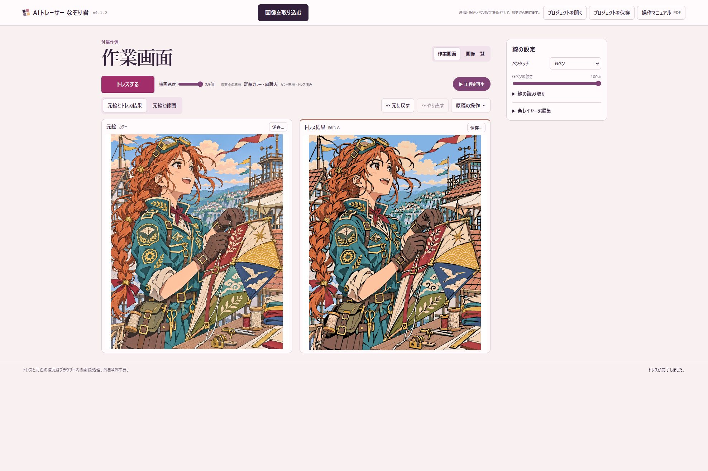
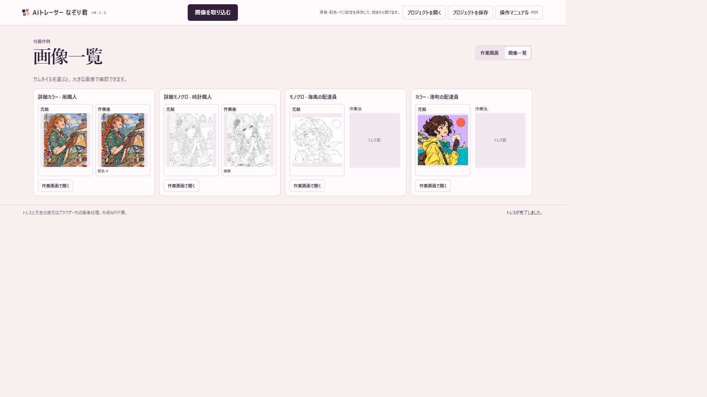
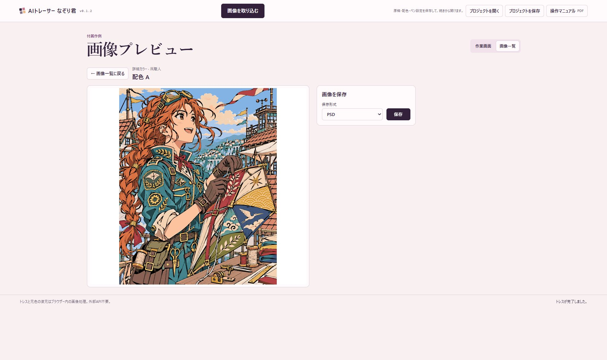

# AI Tracer Nazori-kun / AIトレーサー なぞり君

[](https://furuyan1234.github.io/ai-tracer-nazori-kun/)
[](https://github.com/FURUYAN1234/ai-tracer-nazori-kun/releases/latest/download/nazori-kun-manual.pdf)

[v0.1.4 walkthrough (YouTube) / v0.1.4の操作動画（YouTube）](https://youtu.be/Zf8ESjz5FSs) · [Illustrated guide and narrated demo / 画像付き解説と実演動画（note）](https://note.com/happy_duck780/n/n75301de9493a) · [Releases / リリース](https://github.com/FURUYAN1234/ai-tracer-nazori-kun/releases) · [AI Manga Creative Suite](https://note.com/happy_duck780/n/nbdf826604ce7)

Watch a pen retrace the lines in an illustration. On a color original, a brush then applies colors sampled from the same image. When the drawing ends, the workspace puts the original beside the reconstructed result. / イラストを読み込み、ペン先が元絵をなぞって線を引き直すところを見られます。カラー原稿ではその後、筆が元絵から拾った色を塗ります。工程が終わると、作業画面に元絵とトレス結果が並びます。

The browser runs the entire drawing pipeline locally with explicit algorithms and equations. Line extraction, pen effects, color reconstruction, and replay use no AI model or inference API. No API key or AI subscription is required, and the input image stays in the browser. / 線の抽出、ペンタッチ、元色の復元、描画の再生まで、すべてブラウザー内でアルゴリズムと数式を使って処理します。描画ルーチンにAIモデルや推論APIは使いません。原稿の外部送信、AIサービスへの登録、APIキーは不要です。



## Try the built-in examples / 付属作例で試す

1. Open the web app and click **トレスする** (Trace) on the color kite-maker example. The cursor switches from a pen to a brush. A color result appears on the right when tracing ends. / Webアプリを開き、カラー作例「凧職人」で **トレスする** を押します。ペン先が筆先に切り替わり、最後は右に色付きの結果が並びます。
2. From **画像一覧** (Image list), find the monochrome clock-maker, then choose **作業画面で開く**. Trace it to see how a monochrome original becomes line art. The list also includes two courier samples. / **画像一覧**で白黒の「時計職人」を探し、**作業画面で開く**を押します。白黒原稿は線画まで仕上がります。配達員の白黒・カラー作例も使えます。
3. Choose **画像を取り込む** to work with your own PNG, JPEG or WebP files. You can select multiple files, then switch between them from the image list. / 自分の原稿を使う場合は、上部の **画像を取り込む** からPNG・JPEG・WebPを選びます。複数選択でき、読み込み後は画像一覧から作業する原稿を開けます。


## Change the pen and review the process / ペンタッチを調整し、工程を見る

Choose G-pen, round pen, brush pen, or the extracted outline under **ペンタッチ**. **Gペンの強さ** changes the contrast between thinner and heavier parts of a G-pen stroke. For pale monochrome lines, adjust **線の読み取り → 濃さのしきい値** and run the trace again. / **ペンタッチ** でGペン、丸ペン、筆ペン、輪郭そのままを選べます。**Gペンの強さ** で入り抜きや太さの差を調整します。白黒の淡い線を拾いたい場合は **線の読み取り → 濃さのしきい値** を調整してトレスし直します。

**描画速度** sets the speed of the initial trace. **工程を再生** plays the sequence from the beginning. Pause or seek with the timeline, and change **再生速度** independently. **動画を保存** exports the replay as WebM when the browser provides a supported encoder. / **描画速度** はトレス時の速さです。**工程を再生** で最初から見直せます。一時停止やシークバーで途中へ移動し、**再生速度** を別に調整できます。対応ブラウザーでは **動画を保存** からWebMに保存できます。


For a color result, select a palette swatch, choose a replacement color, and click **適用**. Regions sharing that color layer change together. **配色 AとBを比べる** previews two alternatives. **元に戻す** and **やり直す** can restore changes. / カラー結果の色チップを開き、色を選んで **適用** を押すと、その色レイヤーに入っている箇所が変わります。**配色 AとBを比べる** で二つの配色を見比べることができます。色の変更は **元に戻す**・**やり直す** に対応します。

## Pick an image, then a format / 画像を選び、保存形式を指定する

Open a thumbnail from **画像一覧**, or use **保存…** above an image in the workspace. Confirm the selected image in **画像プレビュー**, choose **保存形式**, and press **保存**. To export only the line art of a color original, open **元絵と線画** and select the line art. For a PSD with color layers, select the color result or the desired palette. / **画像一覧** のサムネイルか、作業画面で絵の上にある **保存…** を押します。**画像プレビュー** で対象を確かめ、**保存形式** を選んで **保存**。カラー原稿の線画だけを保存するなら **元絵と線画** から線画を、色レイヤー付きPSDなら色付きのトレス結果や配色を選びます。



| Format / 形式 | Use / 使い分け |
| --- | --- |
| PNG | Share the selected image, or save the original as PNG. / 選んだ絵を表示・共有したいとき。元絵の保存にも使います。 |
| PSD | Edit ink, individual color layers, and paper in Photoshop or a compatible editor. Layer visibility is preserved. / Photoshopなどでペン線・色別レイヤー・用紙を編集したいとき。色レイヤーの表示状態も保持します。 |
| SVG | Scale the result or edit the shapes in a vector editor. Color areas and ink outlines are saved as vector paths. / 絵を拡大したいときや、ベクター編集ソフトで色面・線の輪郭を調整したいとき。 |
| Coordinate JSON / 座標JSON | Send outlines, replay order and color assignments to another program. The schema is nazori-coordinates/1; pixel coordinates start in the top left. / 自作の再生ツールや変換スクリプトに輪郭・再生順・色の割り当てを渡したいとき。左上が原点で、単位はピクセルです。 |



**プロジェクトを保存** stores original images, palettes, region boundaries, pen and speed settings, and the selected image in a project JSON file. Open it with **プロジェクトを開く** to resume. **原稿の操作 → 同じ設定で原稿を差し替え** lets you use your current pen settings with a new image. / **プロジェクトを保存** は原稿・配色・塗り分け境界・ペン・速度・選択中の画像をプロジェクトJSONに記録します。**プロジェクトを開く** で続きから作業できます。**原稿の操作 → 同じ設定で原稿を差し替え** は、今のペン設定で別の原稿をトレスするときに使います。

For the full illustrated workflow, choose **操作マニュアル PDF** in the application header. The PDF includes the file types, API settings, and local MCP setup. / 画面上部の **操作マニュアル PDF** で、画像付きの手順、保存形式、API設定とローカルMCP連携を確認できます。

### Original-size export / 元寸保存

Each import retains its aspect ratio. The workspace and WebM replay use a preview of up to 1,600 pixels on the long edge. For larger inputs up to 16 million pixels, the image preview offers **元寸** (original size, selected by default) and **プレビュー寸法** (preview size). Original-size PNG, PSD, SVG and coordinate JSON are traced from the original pixels on save, with the selected pen and color edits. Project JSON retains the compressed original when original-size export is available. / 原稿ごとに縦横比を保ち、作業画面とWebMは長辺1,600pxまでで再生します。より大きく1,600万画素以下の原稿では、画像プレビューの **保存サイズ** で **元寸**（初期選択）または **プレビュー寸法** を選べます。元寸では保存時に元の画素をトレスし、ペン・配色の設定を反映してPNG・PSD・SVG・座標JSONを保存します。元寸保存可能な原稿の圧縮原本はプロジェクトJSONにも入ります。

Inputs above 16 million pixels are saved at preview size. Import is limited to 32 million pixels, 8,192 pixels per edge and 24 MB per file. Complex contours or layer data can also exceed the original-size budget. The save screen gives the reason and keeps preview-size export available. / 1,600万画素を超える原稿はプレビュー寸法で保存します。取り込みは3,200万画素、各辺8,192px、1枚24 MBまでです。輪郭やレイヤーの量が上限を超えたときも、理由を画面に表示し、プレビュー寸法で保存できます。

## Design and provenance / 設計と来歴

The application extracts closed outlines around ink, preserves enclosed holes, reconstructs ink from crossings of those outlines, and applies pen weight to the reconstructed ink. The perimeter traversal determines when ink appears. A separate connected-region pass assigns colors, and a clipped back-and-forth brush pass makes the paint visible during replay. / インクの外周と中の穴を閉経路として抽出し、経路との交点から線を再構成してペンタッチを加えます。輪郭を通過した時刻に合わせて線が現れます。彩色は別に領域を抽出し、領域内を往復する筆の動きに合わせて色を出します。

The public X demo and the independent line-trace-strokes repository were concept references. The X demo's internal implementation is unknown. This implementation, UI, replays, and example assets were made for this project. The sample illustrations were created with the built-in ImageGen tool. / Xの公開デモと、別の公開リポジトリであるline-trace-strokesを着想の参考にしました。Xのデモの内部方式は未確認です。実装・画面・再生・作例素材は本プロジェクト用に制作しました。作例の生成には内蔵のImageGenを使用しました。

[X demo / Xの公開デモ](https://x.com/masamune_sakaki/status/2125131744991199307) · [line-trace-strokes](https://github.com/nekomimianko/line-trace-strokes) · [Adobe PSD specification / Adobe PSD仕様](https://www.adobe.com/devnet-apps/photoshop/fileformatashtml/)

[Technical report (EN)](docs/technical-paper-en.md) / [技術報告（日本語）](docs/technical-paper-ja.md)

The system is intended for illustrations with identifiable ink and flat colors. It builds the replay order from the visible contours. Closely related hues can share a representative swatch. / 線とベタ色のあるイラスト向けです。再生順は画像から読み取った輪郭をもとに組み立てます。似た色は一つの代表色にまとめる場合があります。

## Mathematics of the drawing pipeline / 描画ルーチンの数理

The equations below describe the drawing engine. AI-assisted development and the ImageGen sample artwork are part of the project's provenance. The engine uses fixed numerical rules on the supplied raster and settings. / 以下は描画エンジンの実装に沿った数式です。開発ではAIのコーディング支援を、付属作例の制作ではImageGenを使いました。実行時のエンジンは、入力画像と設定に対してコードで定めた計算を行います。

### 1. Pixel scores and thresholding / 画素のスコアと二値化

For 8-bit channels $R,G,B,A$, set $a=A/255$. Compute a weighted RGB brightness $Y$ and channel spread $C$. The alpha terms treat transparency as white. / 8ビットのRGBA値に対し、白地に重ねたときの明るさ $Y$ と色の強さの指標 $C$ を計算します。完全透明なら $Y=255$、 $C=0$ です。

```math
\begin{aligned}
Y&=\mathrm{round}\big(255+a(0.2126R+0.7152G+0.0722B-255)\big)\\
C&=\mathrm{round}\big(a(\max(R,G,B)-\min(R,G,B))\big)
\end{aligned}
```

If the count of pixels with $C\ge18$ exceeds $\max(3,0.004WH)$ for width $W$ and height $H$, the color branch runs. Monochrome uses the score $D=Y$. For color, the code samples four opposing pairs around a pixel, along the horizontal, vertical, and two diagonals. Let $S$ be the maximum of the four pairwise minima. The difference $S-Y$ grows when at least one axis has brighter pixels on both sides of a dark line. / $C\ge18$ の画素数が $\max(3,0.004WH)$ を超えるとカラー処理に進みます。白黒の線スコアは $D=Y$ です。カラーでは水平・垂直・斜め2方向から対象画素を挟む点を取り、ペアごとの小さい明るさのうち最大の値を $S$ とします。少なくとも1方向で両側が明るい暗線ほど $S-Y$ が大きくなります。

```math
\begin{aligned}
D_{\mathrm{dark}}&=2.1Y+4.2C+30\\
D_{\mathrm{ridge}}&=222-2.7\max(0,S-Y)\\
&\quad+0.9C+1.8\max(0,Y-112)\\
D&=\left\lfloor\mathrm{clip}_{[0,255]}\big(\min(D_{\mathrm{dark}},D_{\mathrm{ridge}})\big)\right\rfloor
\end{aligned}
```

Here $\mathrm{clip}_{[l,r]}(z)=\min(r,\max(l,z))$. / $\mathrm{clip}$ は値を指定区間に収める処理です。

A pixel enters the ink mask when $D<\tau$, where the default threshold $\tau$ is 180. Either a low dark-pixel score or a low ridge score can bring a color pixel below the threshold. / しきい値 $\tau$ の初期値は180です。各画素を $D<\tau$ で判定し、カラーでは暗く色味が少ない画素や、周囲に対して細く暗く落ち込む画素が線の候補になります。 [engine.js](engine.js#L233-L271)

### 2. Grid boundaries and even–odd filling / 格子の輪郭と偶奇則

Treat every ink pixel as a unit square. Keep the directed edges that touch background or the image border, then link them into closed paths. At a corner shared only diagonally, the traversal prefers a right turn. Outer rings and hole rings run in opposite directions. At row $y$, intersect the paths with the line through pixel centers at height $y+\tfrac12$. If the sorted crossing coordinates are $x_1,\ldots,x_{2m}$, the ink intervals are

```math
[x_1,x_2)\ \cup\ [x_3,x_4)\ \cup\ \cdots\ \cup\ [x_{2m-1},x_{2m}).
```

インク画素を単位正方形とし、背景や画像の外に接する辺を有向辺として残して閉経路を作ります。斜めに点で接する箇所では右折を優先し、外周と穴の周囲では経路の向きが逆になります。各行の画素の中心を通る走査線では、交点を左から数え、奇数番目で塗り始め、偶数番目で止めます。For crossings at 2, 5, 8 and 11, the result fills $[2,5)$ and $[8,11)$, leaving the middle open. / 交点が2、5、8、11なら、塗るのは $[2,5)$ と $[8,11)$ です。中央の穴が残ります。 [engine.js](engine.js#L81-L139)

### 3. Local ink density and G-pen opacity / 局所インク密度とGペンの不透明度

Let $B(x,y)=1-I(x,y)/255$ for the rebuilt ink value $I$. The engine builds a summed-area table $J(u,v)=\sum_{x<u,\,y<v}B(x,y)$. Four table lookups give the average ink density $s$ in the clipped window $[l,r)\times[t,b)$, with a radius of one to three pixels depending on image size. / 復元したインク値 $I$ を濃さ $B$ に変換し、二次元の累積和を作ります。画像の大きさに応じた半径1〜3画素の近傍について、累積和の四隅だけで平均インク密度 $s$ が求まります。

```math
s=\frac{J(r,b)-J(l,b)-J(r,t)+J(l,t)}{(r-l)(b-t)}.
```

For a pixel with ink opacity $\alpha=B(x,y)$ and strength $g$ equal to the G-pen slider percentage divided by 100, the output opacity is $\alpha'$. / Gペンでは、元の不透明度 $\alpha$ に密度から求めた係数 $q$ を掛けます。インクの周りにも、密度に応じて濃さを足します。強さ $g$ はスライダーの百分率を100で割った値です。

```math
\begin{aligned}
q&=0.27+0.73\mathrm{clip}_{[0,1]}\big((s-0.22)/0.41\big)\\
h&=\alpha q+(1-\alpha)\min(0.68,\,2.15\max(0,s-0.19))\\
\alpha'&=\alpha+g(h-\alpha)
\end{aligned}
```

Sparse ink is softened, while dense neighborhoods retain stronger ink and can darken adjacent pixels. This gives the pen its thin and heavy areas through local density. / 周囲のインクが少ない先端などは薄くなり、密度の高い場所は濃さを保ち、周りにもインクが広がります。 [engine.js](engine.js#L191-L231)

### 4. RGB quantization and connected regions / RGBの量子化と連結領域

The color pass builds a histogram with 5 bits per channel. It considers histogram bins in descending frequency, uses their mean RGBs as candidates, skips candidates within RGB distance 25 of an accepted color, and keeps up to 34 swatches. A pixel's bin is assigned by the squared Euclidean distance from its representative point $b$, computed as $8\lfloor v/8\rfloor+4$ for each channel $v$, to each swatch $c_j$. / 色ごとにRGBの各チャンネルを8刻みで区切り、出現頻度順に各区画の平均色を候補にします。採用済みの色からRGB距離25未満の色は飛ばし、最大34色を採ります。画素はRGB空間で区画の代表点 $b$ から一番近い色 $c_j$ に割り当てます。

```math
d_j^2=(b_R-c_{j,R})^2+(b_G-c_{j,G})^2+(b_B-c_{j,B})^2.
```

Treat non-ink pixels as vertices of a grid graph. An edge joins horizontal or vertical neighbors of the same color class. Breadth-first search labels each connected component. The assignment preserves separate regions when the same color appears in disconnected parts of an illustration. / 線や境界で遮られず、同じ色クラスの画素が上下左右でつながる範囲を、幅優先探索で領域に分けます。同じ色でも離れたパーツには別々の領域番号が付きます。 [Palette / 代表色](engine.js#L273-L322) · [Regions / 領域](engine.js#L19-L56)

### 5. Pen and brush timing / ペンと筆の時間配分

During replay, contours run from longest to shortest. A contour of perimeter $L$ receives a time window proportional to $w(L)=L^{0.82}$, multiplied by $0.17$ when $L\le8$. For contour $i$, a point at distance $d$ along its path seeds an ink reveal time $T_i(d)$. The 4-neighbor queue propagates these times inward, adding $0.002$ per step and capping at 1. / 再生時は周長の長い輪郭から回ります。輪郭 $i$ の開始時刻を先行する輪郭の持ち時間の合計として、輪郭上の距離 $d$ に比例してインクの表示時刻を割り当てます。近接するインク画素へ上下左右に伝え、1歩ごとに $0.002$ を足します。時刻の上限は1です。

```math
T_i(d)=\frac{\sum_{j=1}^{i-1}w(L_j)}{\sum_j w(L_j)}
       +\frac{d}{L_i}\frac{w(L_i)}{\sum_j w(L_j)}.
```

In the color phase, a color layer of area $A_j$ pixels receives a fraction $\sqrt{A_j}/\sum_k\sqrt{A_k}$ of the paint time. Its bounding box is divided into five horizontal bands. In band $b=0,\ldots,4$, let $u$ be the normalized horizontal position across the box. The fraction within the layer's window is $(b+u)/5$ in even bands and $(b+1-u)/5$ in odd bands. Only assigned pixels get a paint time. / 彩色では、色レイヤーごとの画素数 $A_j$ の平方根で持ち時間を配分します。外接矩形を横に5帯に分け、帯番号 $b$ が偶数なら左から右、奇数なら右から左へ進みます。色が割り当てられた画素だけに時刻を付けるので、筆が往復する帯でも領域の外には色が広がりません。

The contour and color schedules reconstruct a plausible drawing process from a still image. A raster by itself provides no record of the artist's original stroke order or pen pressure. / この時間割は完成画像から再生用に組み立てたものです。元の作者の筆順や筆圧の記録は、静止画像に含まれていません。 [Ink timeline / 線の時刻](engine.js#L141-L189) · [Replay and color timing / 再生と彩色の時刻](app.js#L649-L754)

## MCP

Local stdio, Node.js 22.15 or later. Pass a dedicated directory that contains only allowed input and output files. / ローカルの標準入出力で接続します。Node.js 22.15以降で、読み書きを許可する専用フォルダーを指定します。

```text
node mcp.cjs --workspace <absolute-workspace-path>
```

Call `nazori_trace_png` with a relative `input` path to a non-interlaced 8-bit PNG under the workspace. The server writes PNG, PSD, SVG, and coordinate JSON to a newly created subfolder, and returns their relative paths. The MCP handles original-color and monochrome tracing. Replay and color-layer editing are available in the browser UI. / `nazori_trace_png` の `input` に専用フォルダー内の相対パスで非インターレースの8-bit PNGを渡します。新規サブフォルダーにPNG・PSD・SVG・座標JSONを書き、相対パスを返します。MCPはカラー原稿の色復元とモノクロトレスに対応します。工程再生と色レイヤーの編集はブラウザー版で利用できます。

Independent engine tests / エンジンの単体検証

```text
node --test engine.test.cjs
```

## AI Manga Creative Suite applications / 関連アプリ・プラグイン

| Application / アプリ | Use / 用途 | Links / リンク |
| --- | --- | --- |
| Super FURU AI 4-koma System | Create single-page and multipage manga. / 1ページ・複数ページ漫画を制作します。 | [Web](https://furuyan1234.github.io/nano-banana-pro/) · [GitHub](https://github.com/FURUYAN1234/nano-banana-pro) · [Guide / 解説](https://note.com/happy_duck780/n/ndf063558c1f5) |
| AI Story Maker | Build a plot from a topic. / お題からストーリーやプロットを組み立てます。 | [Web](https://furuyan1234.github.io/story-maker/) · [GitHub](https://github.com/FURUYAN1234/story-maker) · [Guide / 解説](https://note.com/happy_duck780/n/nd3d972922868) |
| AI Character Sheet Maker | Create character reference sheets. / キャラクターの設定画を作ります。 | [Web](https://furuyan1234.github.io/character-sheet-maker/) · [GitHub](https://github.com/FURUYAN1234/character-sheet-maker) · [Guide / 解説](https://note.com/happy_duck780/n/neccbebd7d957) |
| AI Comic Translation Tool / AI漫画翻訳ツール | Translate manga and review the translated text. / 漫画の翻訳文を確認・編集して、翻訳画像を生成します。 | [Web](https://furuyan1234.github.io/comic-translation/) · [GitHub](https://github.com/FURUYAN1234/comic-translation) · [Guide / 解説](https://note.com/happy_duck780/n/ne462dfc55ec8) |
| PanoForge / 360° AI Panorama Generator | Build and explore a 360° panorama from one image. / 一枚の画像から360度パノラマを作成し、構図を探せます。 | [Web](https://furuyan1234.github.io/panoforge/) · [GitHub](https://github.com/FURUYAN1234/panoforge) · [Guide / 解説](https://note.com/happy_duck780/n/nb53b121fef88) |
| AI Voice Comic Maker | Turn comic panels into voiced videos. / 4コマ漫画を声とカメラ演出付きの動画にします。 | [GitHub / 配布](https://github.com/FURUYAN1234/ai-voice-comic-maker) · [Guide / 解説](https://note.com/happy_duck780/n/ndc6533c1512f) |
| Monogatari Buzz Maker / 物語バズメーカー | Use public topics as material for comics, videos, or fiction. / 公開WebやRSSの話題を漫画・動画・小説の企画にまとめます。 | [Web](https://furuyan1234.github.io/viral-radar/) · [GitHub](https://github.com/FURUYAN1234/viral-radar) · [Guide / 解説](https://note.com/happy_duck780/n/ncc593101d77f) |
| Narrated Video Maker / ナレーション動画メーカー | Make videos with Japanese narration and subtitles. / 日本語のナレーション・字幕・映像を合わせて動画を作ります。 | [GitHub / 配布](https://github.com/FURUYAN1234/gemini-narration-studio) · [Guide / 解説](https://note.com/happy_duck780/n/n97d49c1c98b1) |
| AI Image Bridge | Edit CLIP STUDIO PAINT EX layers from text prompts. / CLIP STUDIO PAINT EXのレイヤーを文章の指示で編集します。 | [GitHub / 配布](https://github.com/FURUYAN1234/ai-image-bridge) · [Guide / 解説](https://note.com/happy_duck780/n/n6747a089fce7) |

## ComfyUI workflows / ComfyUIワークフロー

| Workflow / ワークフロー | Use / 用途 | Links / リンク |
| --- | --- | --- |
| MiniMax H3 Video | Generate videos with sound from text, a starting image, or references. / 文章・開始画像・参照画像から音声付き動画を作ります。 | [GitHub](https://github.com/FURUYAN1234/comfyui-h3-workflows) · [Guide / 解説](https://note.com/happy_duck780/n/n15e732b3147b) |
| MiniMax H3 MV | Make a music video from an existing song. / 完成した楽曲からミュージックビデオを作ります。 | [GitHub](https://github.com/FURUYAN1234/comfyui-h3-workflows) · [Guide / 解説](https://note.com/happy_duck780/n/ne8a84cb6db37) |
| KomaOrbit | Explore viewpoints in 3D from one illustration. / 一枚のイラストから別の視点や構図を探します。 | [GitHub](https://github.com/FURUYAN1234/comfyui-h3-workflows) · [Guide / 解説](https://note.com/happy_duck780/n/n3f68482d5edd) |
| AnimeSharp Long Video Upscaler / 長尺動画アップスケーラー | Upscale long videos while retaining sound. / 元の音声を引き継ぎながら長尺動画を拡大します。 | [GitHub](https://github.com/FURUYAN1234/comfyui-long-video-upscaler) · [Guide / 解説](https://note.com/happy_duck780/n/n0f190160e307) |
| Japanese Songwriting with YuE2 / 日本語おまかせ作曲 | Generate lyrics and songs from Japanese instructions. / 日本語の指示から歌詞と歌を作ります。 | [GitHub](https://github.com/FURUYAN1234/ComfyUI-YuE2-Japanese) · [Guide / 解説](https://note.com/happy_duck780/n/n57df44cf7fd2) |
| Japanese Narration / 日本語おまかせナレーション | Review readings and synthesize narration. / 読みを確認して日本語のナレーションを作ります。 | [GitHub](https://github.com/FURUYAN1234/ComfyUI-Local-Narration-Japanese) · [Guide / 解説](https://note.com/happy_duck780/n/nda7ed302d544) |
| MangaScreen JP | Convert images into manga line art, solids, and screentones. / 画像を漫画向けの線画・ベタ・網点に仕上げます。 | [GitHub](https://github.com/FURUYAN1234/ComfyUI-MangaScreen-JP) · [Guide / 解説](https://note.com/happy_duck780/n/n5c89a250fb82) |

### Companion tools / 補助ツール

- **Codex Usage / Codex 残量** — A Windows overlay for usage and reset times. / 利用枠やリセット予定をWindows上に表示します。 [GitHub](https://github.com/FURUYAN1234/codex-usage-overlay)
- **Local Handoff MCP** — Pass the current workspace and next steps between local coding agents. / CodexとAntigravityの間で作業フォルダーや次の工程を引き継ぎます。 [GitHub](https://github.com/FURUYAN1234/local-handoff-mcp) · [Guide / 解説](https://note.com/happy_duck780/n/n806c7bc6de94)
